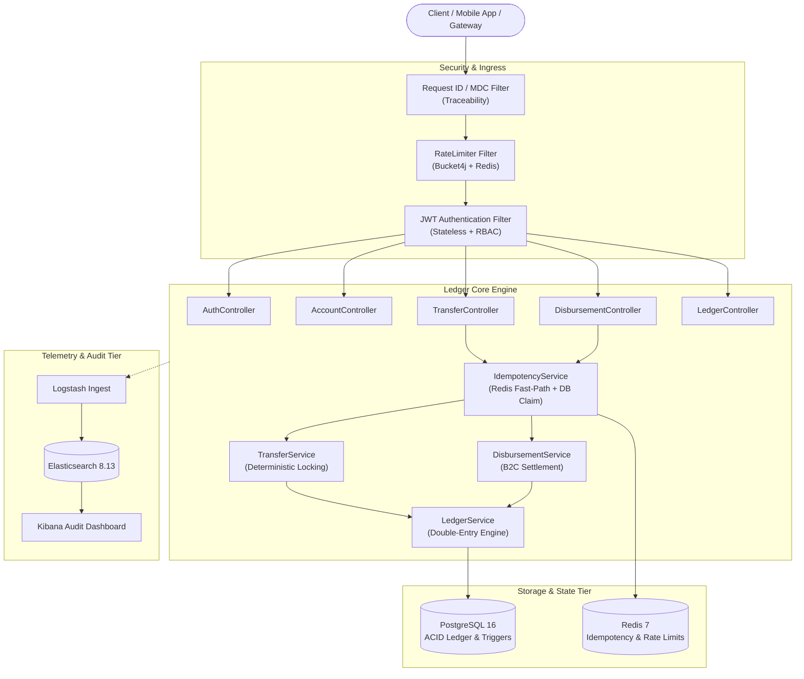
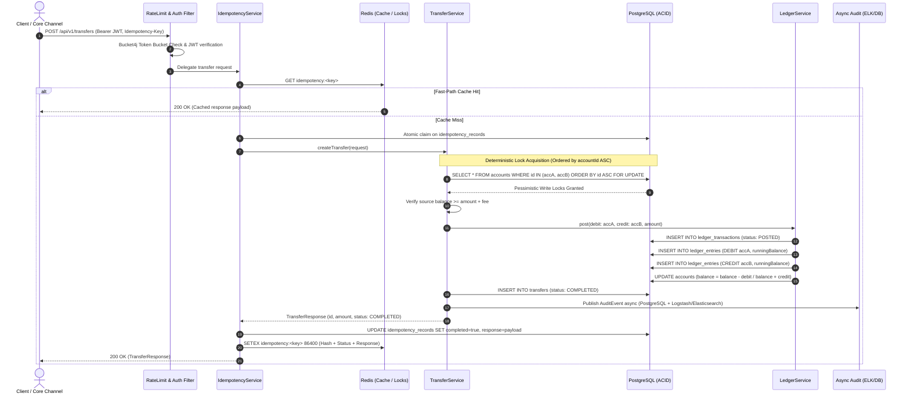
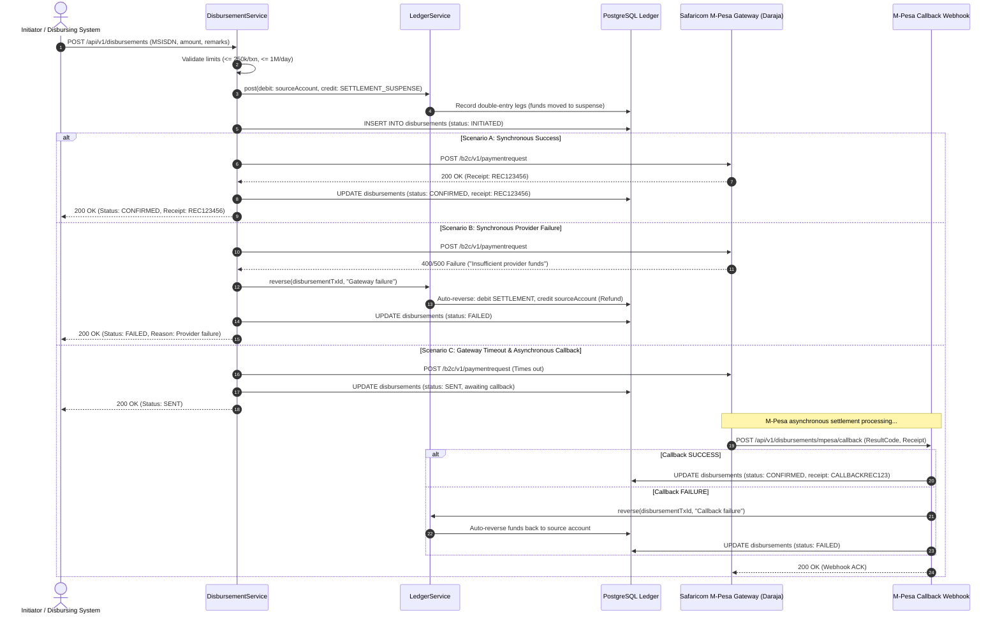
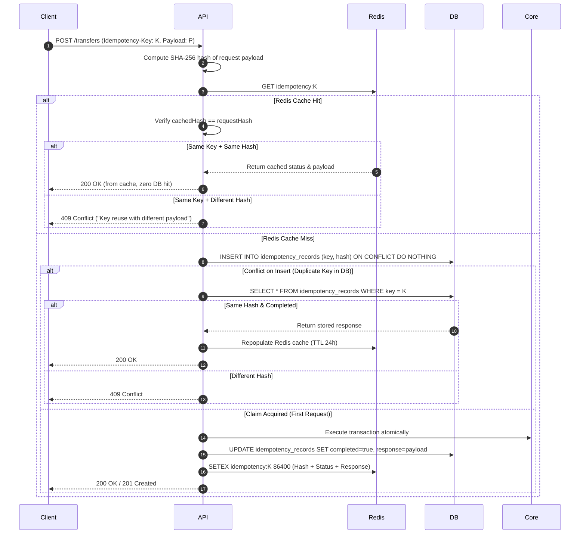

# Ledger Core

[](https://openjdk.org/projects/jdk/21/)
[](https://spring.io/projects/spring-boot)
[](https://www.postgresql.org/)
[](https://redis.io/)
[](https://www.elastic.co/elk-stack)
[](https://www.docker.com/)
[](https://opensource.org/licenses/MIT)

> **Production-grade core banking transaction processing engine modelled on Kenya's Real-Time Gross Settlement (RTGS) and M-Pesa mobile money flows.**
> 
> Engineered for strict ACID correctness, mathematical double-entry invariant verification, deadlock-free pessimistic locking under high concurrent load, and multi-tier idempotency guarantees.

---

## Architecture Overview



---

## Core Financial Guarantees

### 1. Mathematical Double-Entry Invariant
Every financial transaction is recorded as balanced pairs of debit and credit legs. No money is ever created or destroyed in transit:
$$\sum \text{Debit Amounts} = \sum \text{Credit Amounts} = \text{Transaction Amount}$$

* **Debit**: Deducts from an asset account (e.g. sender's balance).
* **Credit**: Increments a liability/deposit account (e.g. receiver's balance).
* **DB-Level Immutability**: Enforced via PostgreSQL triggers. Any direct `UPDATE` or `DELETE` executed on `ledger_entries` throws a fatal SQLSTATE exception. Auditing is strictly append-only.

### 2. Deadlock-Free Deterministic Locking (RTGS Transfer Flow)
To eliminate database deadlocks when two accounts simultaneously transfer funds to each other ($A \rightarrow B$ and $B \rightarrow A$), Ledger Core sorts account IDs deterministically in ascending alphanumeric order before issuing a `SELECT ... FOR UPDATE`:



### 3. Mobile Money Disbursement Flow (M-Pesa B2C Settlement & Reversals)
Modeled on Safaricom M-Pesa B2C settlement flows using a suspense/settlement clearing account, automated gateway retries, timeout management, and asynchronous callback reconciliation:



### 4. Multi-Tier Idempotency Engine
Every state-changing money movement requires an `Idempotency-Key` header with payload hash validation:



---

## Tech Stack & Architecture

| Component | Technology | Rationale |
| :--- | :--- | :--- |
| **Language** | Java 21 LTS | Pattern matching, virtual threads ready, modern records |
| **Framework** | Spring Boot 3.3 / 3.4 | Cloud-native microservice architecture, Spring Security 6, Data JPA |
| **Database** | PostgreSQL 16 | ACID transactions, row-level pessimistic locking, trigger-based immutability |
| **Migrations** | Flyway | Versioned database schema evolution (V1 through V8) |
| **Caching / Locks** | Redis 7 | Sub-millisecond idempotency deduplication and token bucket rate limiting |
| **Rate Limiter** | Bucket4j 8.10 + Redis | Per-IP and per-account burst control and DDoS mitigation |
| **Audit & Logs** | ELK Stack 8.13 | Structured JSON logging with Logback socket appender to Logstash |
| **Testing** | JUnit 5, Mockito, Testcontainers | Real ephemeral PostgreSQL and Redis instances for stress & concurrency testing |
| **Documentation** | OpenAPI 3.0 / Swagger UI | Interactive API documentation with JWT authentication integration |

---

## Project Structure

```text
ledger-core/
├── .github/workflows/ci.yml       # Automated GitHub Actions CI pipeline
├── docker/
│   ├── logstash/pipeline/        # Logstash pipeline configuration
│   └── ...
├── src/
│   ├── main/
│   │   ├── java/ke/ledgercore/
│   │   │   ├── config/           # OpenAPI and Bean configurations
│   │   │   ├── controller/       # REST API endpoints (Auth, Accounts, Transfers, etc.)
│   │   │   ├── dto/              # Request/Response data transfer objects
│   │   │   ├── exception/        # Global exception handling & custom domain errors
│   │   │   ├── model/            # JPA entities (Account, LedgerEntry, Transfer, etc.)
│   │   │   ├── rate/             # Bucket4j Redis-backed RateLimitFilter
│   │   │   ├── repository/       # Spring Data JPA repositories with pessimistic locks
│   │   │   ├── security/         # JWT filters, UserDetailsService, SecurityConfig
│   │   │   └── service/          # Business logic, double-entry engine, M-Pesa gateway
│   │   └── resources/
│   │       ├── db/migration/     # Flyway SQL migrations (V1 to V8)
│   │       ├── application.yml   # Default local development profile
│   │       └── application-docker.yml # Containerized network profile
│   └── test/java/ke/ledgercore/  # Testcontainers concurrency & integration suites
├── docker-compose.yml            # PostgreSQL, Redis, Elasticsearch, Logstash, Kibana, App
├── Dockerfile                    # Multi-stage production build container
├── Makefile                      # Standardized build and operational targets
├── pom.xml                       # Maven build descriptor with Java 21 & JaCoCo rules
└── README.md
```

---

## Quickstart

### Prerequisites
* **Java 21** (Eclipse Temurin 21 recommended)
* **Docker & Docker Compose** (running via Docker Desktop or daemon)

### 1. Clone & Configuration
```bash
git clone https://github.com/your-username/ledger-core.git
cd ledger-core
cp .env.example .env
```

### 2. Start Supporting Infrastructure
Spin up PostgreSQL and Redis:
```bash
make docker-up
# Or: docker compose up -d postgres redis
```

### 3. Build & Run Application Locally
Run with the bundled Maven wrapper:
```bash
# On Linux/macOS
./mvnw spring-boot:run

# On Windows PowerShell
.\mvnw.cmd spring-boot:run
```

The application will start on port `8080`.
* **API Documentation**: [http://localhost:8080/swagger-ui/index.html](http://localhost:8080/swagger-ui/index.html)
* **Health Check**: [http://localhost:8080/actuator/health](http://localhost:8080/actuator/health)

---

### Turnkey Full-Stack Docker Deployment
To launch the complete cluster (API + Postgres + Redis + Elasticsearch + Logstash + Kibana):
```bash
docker compose --profile docker up -d --build
```

---

## Interactive API Walkthrough (cURL)

A complete automated demonstration script is available in [`scripts/demo.sh`](file:///c:/Users/crnji/Videos/Projects/Java/ledger-core/scripts/demo.sh). You can also test the endpoints manually:

### 1. Authenticate & Obtain JWT
```bash
TOKEN=$(curl -s -X POST http://localhost:8080/api/v1/auth/login \
  -H "Content-Type: application/json" \
  -d '{"username":"admin","password":"admin123"}' | jq -r '.token')

echo "JWT: $TOKEN"
```

### 2. Create Accounts
```bash
# Get Admin User ID
USER_ID=$(curl -s -H "Authorization: Bearer $TOKEN" http://localhost:8080/api/v1/auth/me | jq -r '.userId')

# Create Account 1
ACC1_ID=$(curl -s -X POST http://localhost:8080/api/v1/accounts \
  -H "Authorization: Bearer $TOKEN" \
  -H "Content-Type: application/json" \
  -d "{\"userId\": \"$USER_ID\"}" | jq -r '.id')

# Create Account 2
ACC2_ID=$(curl -s -X POST http://localhost:8080/api/v1/accounts \
  -H "Authorization: Bearer $TOKEN" \
  -H "Content-Type: application/json" \
  -d "{\"userId\": \"$USER_ID\"}" | jq -r '.id')
```

### 3. Initial Ledger Deposit (Credit Account 1 with KES 1,000)
```bash
curl -i -X POST http://localhost:8080/api/v1/ledger/post \
  -H "Authorization: Bearer $TOKEN" \
  -H "Idempotency-Key: $(uuidgen)" \
  -H "Content-Type: application/json" \
  -d "{
    \"entries\": [
      {\"accountId\":\"$ACC1_ID\", \"amount\": 1000, \"entryType\": \"CREDIT\"}
    ]
  }"
```

### 4. Idempotent Transfer (Account 1 -> Account 2)
```bash
TRANSFER_KEY=$(uuidgen)

# First Request: Transfer executes and debits $ACC1 / credits $ACC2
curl -i -X POST http://localhost:8080/api/v1/transfers \
  -H "Authorization: Bearer $TOKEN" \
  -H "Idempotency-Key: $TRANSFER_KEY" \
  -H "Content-Type: application/json" \
  -d "{
    \"fromAccountId\":\"$ACC1_ID\",
    \"toAccountId\":\"$ACC2_ID\",
    \"amount\": 250,
    \"description\": \"Internal account transfer\"
  }"

# Second Request (Replay): Returns identical cached response, prevents double-spend
curl -i -X POST http://localhost:8080/api/v1/transfers \
  -H "Authorization: Bearer $TOKEN" \
  -H "Idempotency-Key: $TRANSFER_KEY" \
  -H "Content-Type: application/json" \
  -d "{
    \"fromAccountId\":\"$ACC1_ID\",
    \"toAccountId\":\"$ACC2_ID\",
    \"amount\": 250,
    \"description\": \"Internal account transfer\"
  }"
```

### 5. Mobile Money B2C Disbursement
```bash
curl -i -X POST http://localhost:8080/api/v1/disbursements \
  -H "Authorization: Bearer $TOKEN" \
  -H "Idempotency-Key: $(uuidgen)" \
  -H "Content-Type: application/json" \
  -d "{
    \"fromAccountId\":\"$ACC1_ID\",
    \"msisdn\":\"+254712345678\",
    \"amount\": 150,
    \"remarks\":\"Utility refund\"
  }"
```

### 6. Query Paginated Statement with Running Balance
```bash
curl -s -X GET "http://localhost:8080/api/v1/accounts/$ACC1_ID/statement?page=0&size=10" \
  -H "Authorization: Bearer $TOKEN" | jq .
```

---

## Testing & Quality Assurance

Ledger Core adheres to the testing pyramid with automated unit, concurrency, and containerized integration tests.

```bash
# Run unit and validation tests
./mvnw test

# Run full integration and concurrency suite with Testcontainers
./mvnw clean verify
```

### Test Suite Highlights
* **`TransferConcurrencyTest`**: Spawns multiple threads executing concurrent transfers between accounts in opposing directions. Verifies that account balances never drift, zero updates are lost, and deterministic primary key sorting guarantees zero deadlocks.
* **`IdempotencyIntegrationTest`**: Fires simultaneous parallel requests with matching idempotency keys to verify that only a single database claim is processed.
* **`LedgerIntegrationTest`**: Tests PostgreSQL triggers to verify that direct SQL queries attempting to alter or delete ledger history are rejected.

---

## CI / CD Pipeline

Every push and pull request to `main` and `master` runs a GitHub Actions workflow:
1. **JDK 21 Setup**: Bootstraps Eclipse Temurin 21 with Maven caching.
2. **Build & Test**: Executes `./mvnw -B clean verify`.
3. **JaCoCo Coverage Enforcement**: Asserts $\ge 80\%$ line coverage across core service domains.
4. **Artifact Upload**: Publishes test and JaCoCo coverage reports.

---

## License

This project is licensed under the [MIT License](LICENSE).
